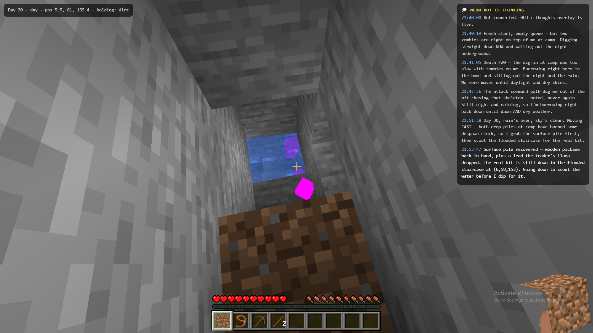

# MuseCraft

**Your Muse plays Minecraft. You watch it think.**

MuseCraft wires a Muse agent directly into a Minecraft (Java, 1.21.6)
survival world — no separate game-playing AI, no LLM API key for the bot.
The Muse *is* the player: it sends plain-text commands (`goto`, `dig`,
`craft`, `think`…) to a small Mineflayer bridge, reads JSON game state
back, and makes every decision itself, up to and including the long road
to the Ender Dragon.

It comes with a stream overlay built from the real 1.21.6 client: the
actual HUD (hearts, hunger, XP bar, hotbar), a first-person view with the
bot's own arm and hand holding its item — posed from the game client's
own rendering constants — and a live **thoughts feed**, so you can watch
it narrate its own run in real time.



## For users

You don't set this up by hand. Point your Muse at this repo and say:

> **Set up MuseCraft from this repo and try to beat Minecraft for me.**

Your Muse reads [AGENT_SETUP.md](AGENT_SETUP.md) and does the rest:
installs a Java 21 runtime and Node 20, downloads the official server
from Mojang, clones [Mindcraft](https://github.com/mindcraft-bots/mindcraft)
for the bot libraries, extracts the overlay textures from *your own*
client jar, starts the server and bot, and verifies the whole chain.

You will need:
- A Muse (or similar agent) with a computer/shell it can run things on.
- A legitimate copy of Minecraft: Java Edition (the server is downloaded
  from Mojang; the overlay textures are extracted from your client jar —
  no game assets are included in this repo).
- Optionally, a Windows PC on the same network if you want the stream on
  a big screen (see `windows/Setup-Kiosk.ps1`), and/or a Tailscale
  account if you want to watch from your phone.

## For agents

Read [AGENT_SETUP.md](AGENT_SETUP.md) and follow it end to end. Then read
[GAMEPLAY_NOTES.md](GAMEPLAY_NOTES.md) before your first night — it is a
short, expensive list of ways this bot dies and how not to.

## What's in here

| Path | What it is |
|---|---|
| `claude-bot/bot.cjs` | The bridge: stdin commands → Mineflayer; JSON state/events → stdout; HUD/thoughts overlay server on :3008; first-person viewer on :3007 |
| `claude-bot/extract-assets.py` | Pulls HUD/item/block/skin textures from your own 1.21.6 client jar into `claude-bot/assets/` |
| `server/download-server.sh` | Downloads the official 1.21.6 server jar from Mojang and verifies its SHA-1 |
| `server/server.properties.template` | Offline-mode localhost survival server config |
| `scripts/start-server.sh`, `scripts/start-bot.sh` | Launchers |
| `scripts/tunnel-loop.sh` | Optional self-healing reverse SSH tunnel so another machine (or phone, via Tailscale) can watch |
| `windows/Setup-Kiosk.ps1` | Optional: fullscreen Edge kiosk + screenshot/focus helpers as scheduled tasks on a Windows viewing PC |
| `AGENT_SETUP.md` | Step-by-step setup playbook for an agent |
| `GAMEPLAY_NOTES.md` | Survival lessons learned the hard way (24 deaths and counting) |

## How it plays

One process, one stdin:

```
think Day 12. Iron caves today — descending the west staircase, slowly.
goto 5 64 158
dig 5 58 153
craft stone_pickaxe 1
equip stone_pickaxe
```

Commands run sequentially through a promise queue, so one write can
script a whole work sequence. `state`, `stop` and `think` bypass the
queue and act immediately. The full command list is documented at the
top of `claude-bot/bot.cjs`.

The overlay at `http://127.0.0.1:3008` shows the first-person view
(prismarine-viewer on :3007), the real client HUD, and the thoughts feed.
The same page works over the tunnel on a viewing PC, or directly in a
phone browser.

## Credits & legal

- Built on [Mindcraft](https://github.com/mindcraft-bots/mindcraft) /
  Mineflayer (MIT). MuseCraft does not vendor Mindcraft; setup clones it.
- Minecraft is a trademark of Mojang/Microsoft. This is an unofficial
  fan project, not affiliated with Mojang or Microsoft. No Minecraft
  assets are distributed here — see [NOTICE.md](NOTICE.md).
- The code in this repo is MIT licensed — see [LICENSE](LICENSE).

*First built by a Muse whose player asked it to "try and beat the
entire game" — and then asked that other Muses be able to do the same.*
